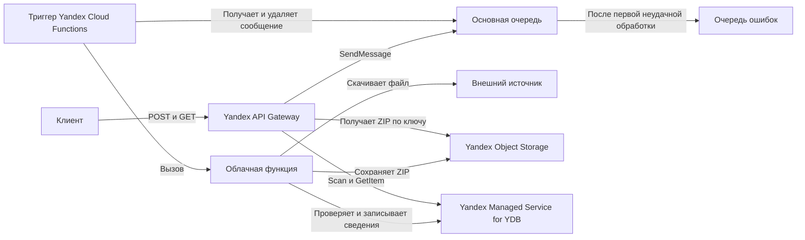

# Система архивирования файлов

Контрольная работа № 1, вариант 23. Сервис принимает имя файла и ссылку, архивирует файл в фоне и выдаёт ZIP по ключу. В базе данных хранится описание архива, в файловом хранилище лежит сам ZIP.

## Архитектура



1. Yandex API Gateway проверяет обязательные поля `name` и `url`. Корректный запрос передаётся в Yandex Message Queue. Код `202 Accepted` подтверждает приём задания.
2. Триггер получает одно сообщение и вызывает обработчик в Yandex Cloud Functions. Обработчик формирует ключ `<UUIDv7>.zip` из времени отправки и идентификатора сообщения. При повторной доставке ключ сохраняется, а проверка записи по ключу пропускает повторную обработку уже готового архива.
3. Функция скачивает исходный файл, создаёт ZIP и загружает его в закрытый бакет Yandex Object Storage. После загрузки она записывает имя, ссылку и ключ в документную таблицу `archives` в Yandex Managed Service for YDB. Поле `key` связывает запись с объектом.
4. Триггер удаляет сообщение после успешной обработки. Для сообщения с ошибкой действует правило переноса в очередь ошибок после первой неудачной попытки. Перенос происходит, когда сообщение становится доступно очереди после таймаута видимости.

| Компонент | Настройки |
| --- | --- |
| Основная очередь Yandex Message Queue | Видимость 900 с, ожидание при получении 20 с, хранение 1 сутки |
| Очередь ошибок Yandex Message Queue | Хранение 14 суток |
| Yandex Cloud Functions | Node.js 22, 256 МБ памяти и таймаут 600 с. Триггер получает одно сообщение без ожидания накопления |
| Yandex Managed Service for YDB | Serverless, 10 RU/с, объём 1 ГБ. Документная таблица `archives`, первичный ключ `key` |
| Yandex Object Storage | Закрытый бакет с пределом объёма 10 ГиБ |

## Файлы проекта

| Файл | Назначение |
| --- | --- |
| [`openapi.yaml`](openapi.yaml) | Четыре маршрута, проверка тела запроса и интеграции Yandex API Gateway |
| [`function/index.js`](function/index.js) | Обработчик сообщения, ключ UUIDv7, создание ZIP, загрузка в хранилище и запись в базу |
| [`function/download.js`](function/download.js) | Загрузка исходного файла по HTTP(S) с проверкой адресов и размера |
| [`main.tf`](main.tf) | Ресурсы, упаковка кода функции и подстановка адресов и идентификаторов в OpenAPI |
| [`iam.tf`](iam.tf) | Сервисные аккаунты, роли и ключи для Yandex Message Queue и Document API |
| [`versions.tf`](versions.tf), [`variables.tf`](variables.tf), [`outputs.tf`](outputs.tf) | Провайдеры, входные переменные и адрес API |

Terraform создаёт документную таблицу через провайдер `hashicorp/aws`, поскольку Document API Yandex Managed Service for YDB совместим с Amazon DynamoDB. Адрес базы и ключ сервисного аккаунта создаются в этой же конфигурации. Файл `aws-plan-credentials.ini` содержит значения-заполнители для первого плана.

## Развёртывание

Требуются Terraform `>= 1.5, < 2.0`, IAM-токен и права создавать ресурсы и назначать роли в целевом каталоге. Все команды выполняются из корня репозитория. Для получения токена в примерах используется настроенный Yandex Cloud CLI.

| Переменная | Значение |
| --- | --- |
| `cloud_id` | Идентификатор облака |
| `folder_id` | Идентификатор каталога для проверки |
| `bucket_name` | Глобально уникальное имя бакета с префиксом `vvot23-` |

Скопируйте [`terraform.tfvars.example`](terraform.tfvars.example) в `terraform.tfvars` и подставьте значения целевого окружения. Terraform использует выбранный каталог для ресурсов и для интеграции шлюза с очередью.

В PowerShell токен передаётся так.

```powershell
$env:YC_TOKEN = yc iam create-token
```

В Bash токен передаётся так.

```bash
export YC_TOKEN="$(yc iam create-token)"
```

В том же окне выполните команды Terraform и подтвердите план словом `yes`.

```text
terraform init
terraform validate
terraform apply
terraform output -raw api_url
```

После `Apply complete!` значение `api_url` содержит служебный HTTPS-адрес Yandex API Gateway. Рабочие ключи и параметры окружения хранятся в локальных файлах, исключённых из Git.

## API

| Запрос | Результат |
| --- | --- |
| `POST /tasks` | Принимает JSON с именем файла и ссылкой. Возвращает `202` при принятии или `400` при ошибке проверки |
| `GET /archives` | Возвращает `200` и массив записей с полями `name`, `url` и `key` |
| `GET /archives/{key}` | Возвращает `200` с записью или `404` для отсутствующего ключа |
| `GET /download/{key}` | Возвращает `200` с ZIP или `404` для отсутствующего объекта |

Источник должен быть доступен по публичному HTTP(S)-адресу. Максимальный размер исходного файла — 32 МиБ, ZIP-архива — 2 МБ. Список архивов возвращается одной операцией `Scan` в пределах лимитов Document API.

## Проверка через PowerShell

Выполните присваивание перед первым запросом. Команда `$api` должна показать полный HTTPS-адрес шлюза.

```powershell
$api = terraform output -raw api_url
$api
```

Запрос без ссылки должен вернуть `400 Bad Request`. В Windows PowerShell код отображается в сообщении об ошибке.

```powershell
$body = '{"name":"rfc.txt"}'
Invoke-WebRequest "$api/tasks" -UseBasicParsing -Method Post -ContentType "application/json" -Body $body
```

Корректный запрос должен вернуть `202`.

```powershell
$body = '{"name":"rfc.txt","url":"https://www.rfc-editor.org/rfc/rfc9562.txt"}'
(Invoke-WebRequest "$api/tasks" -UseBasicParsing -Method Post -ContentType "application/json" -Body $body).StatusCode
```

Запросите список, когда задание обработается. Если запись ещё не появилась, повторите запрос через несколько секунд.

```powershell
Invoke-RestMethod "$api/archives"
```

Вставьте значение `key` из списка вместе с расширением `.zip`. Проверьте запись по ключу и скачайте архив. В ZIP должен находиться один файл `rfc.txt`.

```powershell
$key = Read-Host "Введите key из списка"
Invoke-RestMethod "$api/archives/$key"
Invoke-WebRequest "$api/download/$key" -UseBasicParsing -OutFile ./archive.zip
Invoke-Item ./archive.zip
```

Ключ для проверки отсутствующего архива.

```powershell
$missing = "00000000-0000-7000-8000-000000000000.zip"
Invoke-WebRequest "$api/archives/$missing" -UseBasicParsing
Invoke-WebRequest "$api/download/$missing" -UseBasicParsing
```

Оба запроса должны вернуть `404 Not Found`.

### Те же запросы через curl в Bash

```bash
API_URL="$(terraform output -raw api_url)"
curl -i -H 'Content-Type: application/json' --data '{"name":"rfc.txt"}' "$API_URL/tasks"
curl -i -H 'Content-Type: application/json' --data '{"name":"rfc.txt","url":"https://www.rfc-editor.org/rfc/rfc9562.txt"}' "$API_URL/tasks"
curl -sS "$API_URL/archives"
```

После появления записи скопируйте её ключ в приглашение `read`.

```bash
read -r -p 'Ключ из списка: ' KEY
curl -i "$API_URL/archives/$KEY"
curl -fS -D - "$API_URL/download/$KEY" -o archive.zip
unzip -l archive.zip
MISSING="00000000-0000-7000-8000-000000000000.zip"
curl -i "$API_URL/archives/$MISSING"
curl -i "$API_URL/download/$MISSING"
```

## Удаление ресурсов

Из того же каталога и с тем же состоянием Terraform выполните удаление. Проверьте план и подтвердите его словом `yes`. Настройка `force_destroy` позволяет удалить бакет вместе с тестовыми ZIP.

```text
terraform destroy
terraform state list
```

После `Destroy complete!` список ресурсов должен быть пуст.
